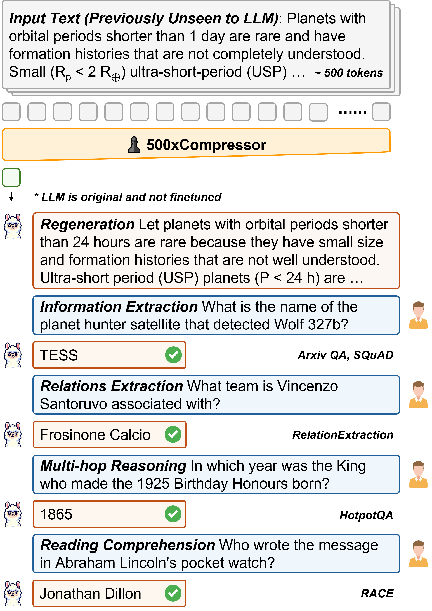
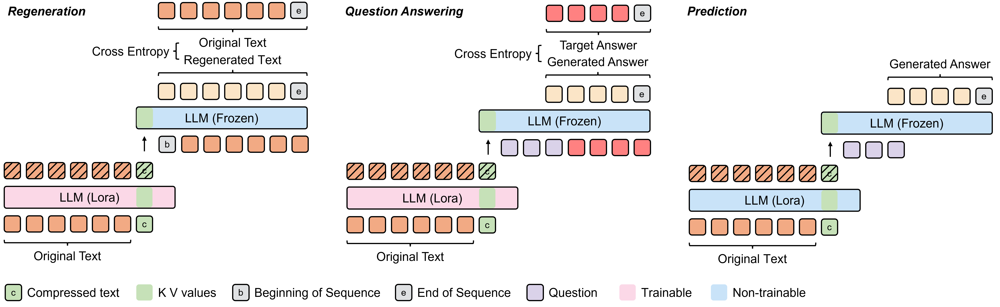
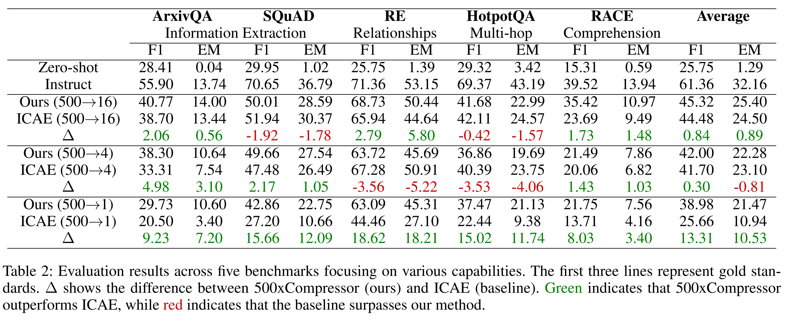
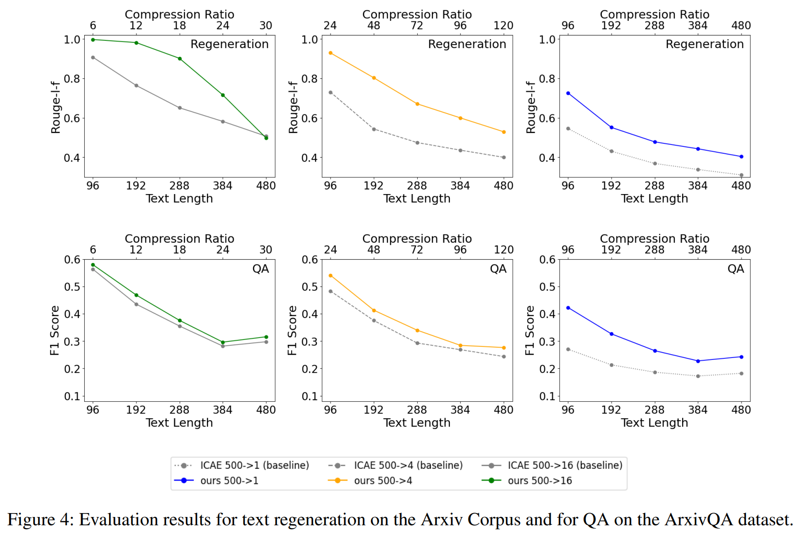
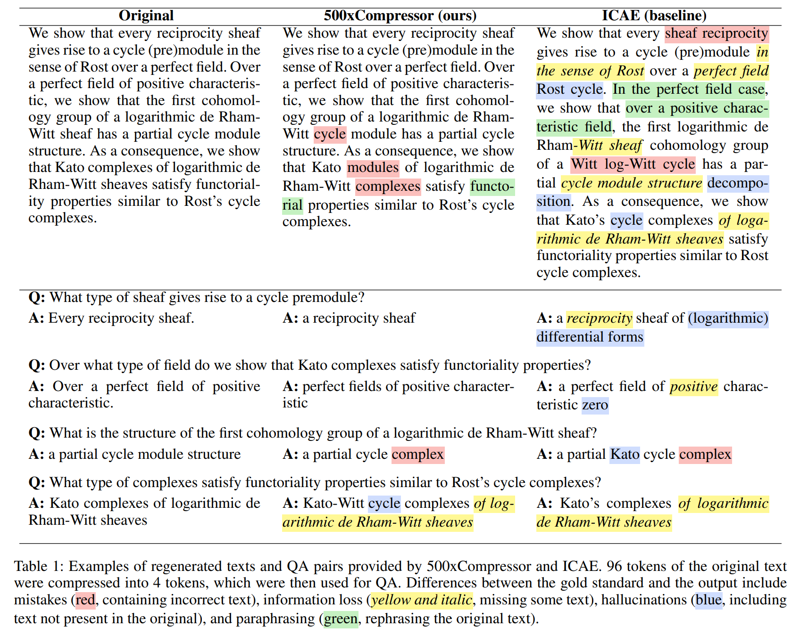

# [ACL 2025 Main] ♟️ 500xCompressor: Compresión de prompts generalizada para modelos de lenguaje grandes

<p align="center">
  <b>Contenido</b>
</p>

<p align="center">
  <a href="#news">🚀Noticias</a> •
  <a href="#todo">✏️Por hacer</a> •
  <a href="#introduction">✨Introducción</a>
</p>

<p align="center">
  <a href="#corpus">📚Corpus</a> •
  <a href="#dataset">🤗Dataset</a> •
  <a href="#model">🤗Modelos</a>
</p>

<p align="center">
  <a href="#download">💾 Descarga</a> •
  <a href="#citation">📌Cita</a> •
  <a href="#license">🔖Licencia</a>
</p>

<p align="center">
  <b>Enlaces</b>
</p>

<p align="center">
  <a href="">Página del proyecto</a> •
  <a href="">Página de demostración</a> •
  <a href="https://arxiv.org/abs/2408.03094">Artículo</a>
</p>

<div id="news">&nbsp;</div>


## 🚀 Noticias

- **[2025.05.15]** El artículo fue aceptado en ACL 2025 Main.
- **[2024.08.06]** El artículo se subió a Arxiv.

<div>&nbsp;</div>
<div>&nbsp;</div>
<div id="todo">&nbsp;</div>


## ✏️ Por hacer

- [ ] Los conjuntos de datos y modelos se subieron a Huggingface pero no están abiertos al público.

<div>&nbsp;</div>
<div>&nbsp;</div>
<div id="introduction">&nbsp;</div>


## ✨ Introducción

**500xCompressor** es un **método de compresión de prompts** que puede comprimir un máximo de **500** tokens de lenguaje natural en solo **1** token especial. Este token comprimido puede **regenerar** el texto original o usarse para **respuesta a preguntas (QA)**.

Inicialmente, 500xCompressor se entrenó en el **Corpus Arxiv**, seguido de un ajuste fino en el **conjunto de datos ArxivQA**, y posteriormente evaluado en varios **conjuntos de datos estrictamente no vistos** y **clásicos** de **QA**.

500xCompressor tiene varias **características y ventajas**:
- **Pequeños parámetros adicionales:** solo **0.3%** de parámetros adicionales se añaden al LLM
- **Uso sin ajuste:** los tokens comprimidos pueden ser usados por el LLM original **sin necesidad de ajuste adicional**
- **Alta proporción de compresión:** desde **6x** hasta **480x**
- **Habilidad de generalización:** puede comprimir cualquier texto **no visto** y usarse para **conjuntos de datos no vistos** en tareas posteriores
- **No selectivo:** comprime **todos** los tokens en el prompt en lugar de seleccionar tokens parciales
- **Capacidades mantenidas:** **62.26-72.89%** de las habilidades del LLM en comparación con prompts no comprimidos

Esta investigación proporcionó varias **observaciones**:
- **No** todos los tokens comprimidos son **igualmente** utilizados
- Los valores **K V** tienen ventajas significativas sobre **incrustaciones** en preservar información a altas proporciones de compresión
- Los prompts en lenguaje natural son **altamente comprimibles**
- La información compleja y fina podría ser comprimida y recuperada exactamente igual que la original

Aquí hay un ejemplo:

<p align="left">
  
</p>

<div>&nbsp;</div>
<div>&nbsp;</div>
<div id="corpus">&nbsp;</div>


## 📚 Corpus Arxiv

Este es un conjunto de **resúmenes de Arxiv**:

- **Entrenamiento:** 2353924 elementos, basado en resúmenes de Arxiv antes de 07/2023
- **Validación:** 3000 elementos, basado en resúmenes de Arxiv durante 01-04/2024
- **Prueba:** 2500 elementos, basado en resúmenes de Arxiv durante 01-04/2024

<div>&nbsp;</div>
<div>&nbsp;</div>
<div id="dataset">&nbsp;</div>


## 🤗 Conjunto de datos ArxivQA

Este es un **conjunto de datos de extracción de respuestas a preguntas** creado basado en los resúmenes de los artículos de Arxiv:

- **Entrenamiento:** 250000 elementos, basado en resúmenes de Arxiv antes de 07/2023
- **Validación:** 1000 elementos, basado en resúmenes de Arxiv antes de 07/2023
- **Prueba:** 1000 elementos, basado en resúmenes de Arxiv durante 01-04/2024

<div>&nbsp;</div>
<div>&nbsp;</div>
<div id="model">&nbsp;</div>


## 🤗 500xCompressor

### Uso rápido para 500xCompressor (nuestro modelo):

> **Debe tenerse en cuenta que el entorno debe ser el mismo que el proporcionado en /env, de lo contrario el modelo podría producir contenido en blanco.**

```
# códigos
python 500xCompressor_demo.py
```
```
# Ejemplo: 4 tokens comprimen 96 tokens

# entrada
context = """We show that every reciprocity sheaf gives rise to a cycle (pre)module in the sense of Rost over a perfect field. Over a perfect field of positive characteristic, we show that the first cohomology group of a logarithmic de Rham-Witt sheaf has a partial cycle module structure. As a consequence, we show that Kato complexes of logarithmic de Rham-Witt sheaves satisfy functoriality properties similar to Rost's cycle complexes."""
question = "Over what type of field do we show that Kato complexes satisfy functoriality properties?"

# salida
Regeneración:
Texto predicho: We show that every reciprocity sheaf gives rise to a cycle (pre)module in the sense of Rost over a perfect field. Over a perfect field of positive characteristic, we show that the first cohomology group of a logarithmic de Rham-Witt cycle module has a partial cycle structure. As a consequence, we show that Kato modules of logarithmic de Rham-Witt complexes satisfy functorial properties similar to Rost's cycle complexes.
QA:
Texto predicho: perfect fields of positive characteristic
```

<div>&nbsp;</div>

### Uso rápido para ICAE (línea base):

> **Debe tenerse en cuenta que el entorno debe ser el mismo que el proporcionado en /env, de lo contrario el modelo podría producir contenido en blanco.**

```
# códigos
python ICAE_demo.py
```
```
# Ejemplo: 4 tokens comprimen 96 tokens

# entrada
context = """We show that every reciprocity sheaf gives rise to a cycle (pre)module in the sense of Rost over a perfect field. Over a perfect field of positive characteristic, we show that the first cohomology group of a logarithmic de Rham-Witt sheaf has a partial cycle module structure. As a consequence, we show that Kato complexes of logarithmic de Rham-Witt sheaves satisfy functoriality properties similar to Rost's cycle complexes."""
question = "Over what type of field do we show that Kato complexes satisfy functoriality properties?"

# salida
Regeneración:
Texto predicho: We show that every sheaf reciprocity gives rise to a cycle (pre)module over a Rost cycle. In the perfect field case, we show that over a positive characteristic field, the first logarithmic de Rham cohomology group of a Witt log-Witt cycle has a partial decomposition. As a consequence, we show that Kato's cycle complexes satisfy functoriality properties similar to Rost cycle complexes.
QA:
Texto predicho: a perfect field of characteristic zero
```

<div>&nbsp;</div>

### Proceso de entrenamiento: 

El modelo de compresión se entrenó en el **Corpus Arxiv** para **regenerar** el texto original según los tokens comprimidos. Luego, se ajustó fine-tuning en el **Conjunto de datos ArxivQA** para **responder preguntas** basado en los tokens comprimidos.

<p align="left">
  
</p>

<div>&nbsp;</div>

### Rendimiento: 

Los modelos de compresión fueron evaluados en varios **conjuntos de datos estrictamente no vistos** y **clásicos** de **QA**.

<p align="left">
  
</p>

Los resultados detallados para **ArxivQA**:

<p align="left">
  
</p>

Aquí hay un **ejemplo**:

<p align="left">
  
</p>

<div>&nbsp;</div>
<div>&nbsp;</div>
<div id="download">&nbsp;</div>


## 💾 Descarga

> Los conjuntos de datos y modelos se subieron a Huggingface pero no están abiertos al público.

Los modelos son los **parámetros LORA** para ajustar LLaMa-3-8b-Instruct. **Regeneración** significa preentrenar el modelo de compresión para regenerar el texto original basado en los tokens comprimidos. **QA** significa ajustar fine-tuning el modelo de compresión para extracción de preguntas basado en los tokens comprimidos. **500->X** significa que 500 tokens en el texto original se comprimen en X tokens especiales.
- [Conjunto de datos ArxivQA](https://huggingface.co/datasets/ZongqianLi/ArxivQA)
- [Nuestro modelo: 500xCompressor Regeneración & QA (500->16, 500->4, 500->1) (2*3 modelos)](https://huggingface.co/collections/ZongqianLi/500xcompressor-66b24b2db2efe5732539a3d3)
- [Líneas base: ICAE Regeneración & QA (500->16, 500->4, 500->1) (2*3 modelos)](https://huggingface.co/collections/ZongqianLi/icae-66b250fdc40442c79e9fb88c)

<div>&nbsp;</div>
<div>&nbsp;</div>
<div id="citation">&nbsp;</div>


## 📌 Cita

```
@inproceedings{li-etal-2025-500xcompressor,
    title = "500x{C}ompressor: Compresión de prompts generalizada para modelos de lenguaje grandes",
    author = "Li, Zongqian  and
      Su, Yixuan  and
      Collier, Nigel",
    editor = "Che, Wanxiang  and
      Nabende, Joyce  and
      Shutova, Ekaterina  and
      Pilehvar, Mohammad Taher",
    booktitle = "Proceedings of the 63rd Annual Meeting of the Association for Computational Linguistics (Volume 1: Long Papers)",
    month = jul,
    year = "2025",
    address = "Viena, Austria",
    publisher = "Association for Computational Linguistics",
    url = "https://aclanthology.org/2025.acl-long.1219/",
    doi = "10.18653/v1/2025.acl-long.1219",
    pages = "25081--25091",
    ISBN = "979-8-89176-251-0",
}
```

<div>&nbsp;</div>
<div>&nbsp;</div>
<div id="license">&nbsp;</div>


## 🔖 Licencia

Este proyecto está licenciado bajo la **Licencia Creative Commons Atribución 4.0 Internacional** - ver [LICENSE](https://creativecommons.org/licenses/by/4.0/deed.en) para más detalles.

[](https://creativecommons.org/licenses/by/4.0/)


</p>
